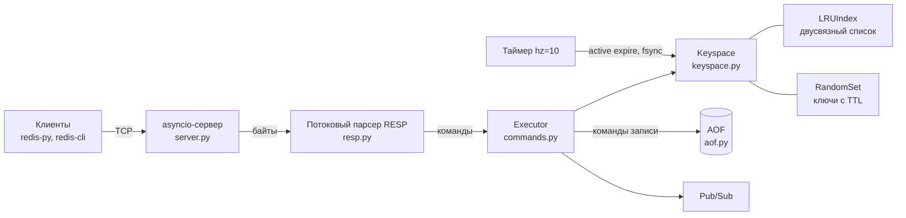

# minikv

[](https://github.com/den123591/minikv/actions/workflows/ci.yml)


Redis-совместимое key-value хранилище на чистом Python: только стандартная библиотека,
ни одной зависимости. С ним работают официальный клиент **redis-py** и **redis-cli**.

> *A Redis-compatible in-memory key-value server in pure Python: RESP2/RESP3, TTL with lazy and
> active expiry, LRU eviction, MULTI/EXEC/WATCH, pub/sub and an append-only file with rewrite.*

Проект про основы backend-разработки без фреймворков: сетевой протокол, асинхронный сервер,
структуры данных, конкурентный доступ и надёжное хранение на диске.

```text
$ minikv-server --aof data.aof &
$ minikv-cli
127.0.0.1:6380> SET user:1 "Даниил" EX 60
OK
127.0.0.1:6380> TTL user:1
(integer) 60
127.0.0.1:6380> RPUSH queue job1 job2
(integer) 2
127.0.0.1:6380> HSET profile city Moscow role intern
(integer) 2
127.0.0.1:6380> HGETALL profile
1) "city"
2) "Moscow"
3) "role"
4) "intern"
```

## Что реализовано

| Область | Команды и механизмы |
|---|---|
| Протокол | RESP2 и RESP3 (`HELLO 3`), pipelining, inline-команды как из telnet, лимиты против огромных входных данных |
| Строки | `GET SET` (`NX XX GET EX PX EXAT PXAT KEEPTTL`), `MGET MSET GETDEL SETNX INCR DECR INCRBY DECRBY APPEND STRLEN` |
| Ключи и TTL | `DEL EXISTS TYPE KEYS RENAME EXPIRE PEXPIRE EXPIREAT PEXPIREAT TTL PTTL PERSIST` |
| Списки, хеши, множества | `LPUSH RPUSH LPOP RPOP LRANGE LLEN LINDEX`, `HSET HGET HDEL HGETALL HINCRBY HKEYS HVALS HLEN HEXISTS`, `SADD SREM SMEMBERS SISMEMBER SCARD` |
| Транзакции | `MULTI EXEC DISCARD`, оптимистичная блокировка `WATCH`/`UNWATCH` |
| Pub/Sub | `SUBSCRIBE PSUBSCRIBE UNSUBSCRIBE PUNSUBSCRIBE PUBLISH`, push-сообщения в RESP3 |
| Память | лимит ключей, политики `noeviction` и `allkeys-lru` |
| Диск | append-only file с политиками fsync `always/everysec/no`, восстановление после оборванной записи, компактная перезапись `BGREWRITEAOF` |
| Сервис | `PING ECHO INFO DBSIZE FLUSHDB TIME SELECT CLIENT COMMAND QUIT` |

## Как устроено



```
src/minikv/
├── resp.py          # кодирование ответов и потоковый парсер RESP2/RESP3
├── structures.py    # LRUIndex (двусвязный список + dict), RandomSet (O(1) + случайная выборка)
├── keyspace.py      # значения, TTL, вытеснение, отслеживание изменений для WATCH
├── commands.py      # декоратор @command, ~60 команд, Executor с MULTI/EXEC/WATCH
├── pubsub.py        # каналы и шаблоны подписок
├── aof.py           # журнал, загрузка с восстановлением, атомарная перезапись
├── server.py        # TCP-сервер на asyncio, фоновые задачи
├── client.py        # асинхронный клиент для тестов и бенчмарка
└── cli.py           # minikv-server и minikv-cli
```

## Интересные места

**Однопоточность вместо блокировок.** Как и Redis, сервер выполняет команды по одной в
цикле событий asyncio. Пока работает `INCR`, никто другой не выполняется, поэтому 20 клиентов,
каждый из которых делает по 100 `INCR`, всегда дают ровно 2000. Это проверяется тестом.
Сеть при этом не блокирует: пока один клиент медленно присылает данные, остальные обслуживаются.

**Потоковый парсер.** TCP не сохраняет границы сообщений: команда может прийти по байту,
а сотня команд — одним пакетом. Парсер копит байты и отдаёт только целые сообщения. Тест
разрезает поток команд в каждой возможной точке и сверяет результат.

**Два способа удалять просроченные ключи.** Лениво — при обращении к ключу. Активно — 10 раз
в секунду берётся случайная выборка из 20 ключей с TTL, и если просрочено больше 25%, проверка
повторяется. Для случайной выборки за O(k) написан `RandomSet`: список + словарь индексов,
удаление через замену на последний элемент.

**LRU за O(1).** `LRUIndex` — словарь «ключ → узел» и двусвязный список с sentinel-узлом.
`OrderedDict` умеет то же, но здесь видно, откуда берётся O(1). Дифференциальный тест гоняет
2000 случайных операций и сравнивает поведение с `OrderedDict`.

**WATCH — оптимистичная блокировка.** Клиент наблюдает за ключом. Если до `EXEC` его изменил
кто-то другой (или он истёк), транзакция не выполняется, и клиент повторяет попытку.
Тест с redis-py проверяет именно такой сценарий: конкурент вмешивается между `GET` и `EXEC`.

**AOF пишет абсолютное время.** `EXPIRE k 10` записывается в журнал как `PEXPIREAT k <время>`.
Иначе после перезапуска TTL отсчитался бы заново и ключ прожил бы дольше положенного.
Перезапись журнала идёт во временный файл и атомарно подменяет старый через `os.replace`.

## Производительность

```bash
python scripts/benchmark.py --clients 50 --requests 2000 --pipeline 1
```

| Pipelining | Операций в секунду | Задержка на пачку p50 / p99 |
|---|---|---|
| нет (1 команда) | ~35 000 | 1.4 / 1.8 мс |
| 16 команд | ~89 000 | 8.9 / 10.0 мс |
| 64 команды | ~109 000 | 28.9 / 31.2 мс |

Apple M2, Python 3.14, 50 параллельных клиентов, смесь SET/GET, 100 000 операций. Клиенты
и сервер работают в одном процессе, поэтому в цифры входит и работа клиента. Настоящий
Redis на C быстрее на порядок, а цель здесь — понятная реализация. Видно главное:
pipelining в разы снижает накладные расходы на сеть и системные вызовы.

## Запуск

```bash
git clone https://github.com/den123591/minikv.git && cd minikv
python -m venv .venv && source .venv/bin/activate
pip install -e ".[dev]"

minikv-server --port 6380 --aof data.aof --max-keys 100000 --eviction allkeys-lru
minikv-cli -p 6380            # или redis-cli -p 6380
```

Из Python через официальный клиент:

```python
import redis
r = redis.Redis(port=6380, decode_responses=True)
r.set("hello", "world", ex=60)
```

## Тесты

```bash
pytest        # 182 теста, меньше секунды
```

- протокол: все типы RESP2/RESP3, разрезание потока в каждой точке, защитные лимиты;
- структуры: дифференциальный тест LRU против `OrderedDict`;
- команды: семантика Redis, включая ошибки (`WRONGTYPE`, переполнение, синтаксис);
- AOF: перезапуск, TTL после простоя, оборванный хвост, незавершённая транзакция, перезапись;
- сервер: pipelining, атомарность при конкурентных клиентах, WATCH, pub/sub, фоновое истечение;
- совместимость: тот же набор сценариев через **redis-py** в режимах RESP2 и RESP3.

## Чего нет

Репликации, кластера, Lua-скриптов, `SCAN`, сортированных множеств и лимита памяти в байтах
(лимит считается в ключах). Это осознанные границы учебного проекта.

## Как я работал с AI

[docs/ai-workflow.md](docs/ai-workflow.md): что делал агент, что проверял я и где были ошибки.

## Лицензия

MIT
